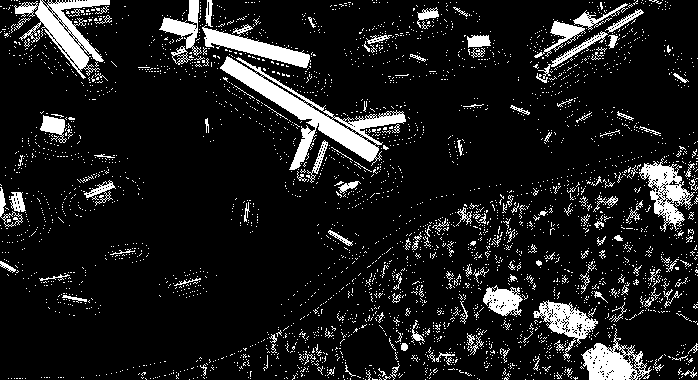

<div align="center">

# 浸水村 · Flooded Village

**A one-bit boat game about a drowned Japanese village.**
Collect drifting logs, keep your little boat afloat, rebuild the broken dam.

### [▶ Play in the browser](https://dariyxyz.github.io/flooded-village/)



</div>

---

## The game

The dam has burst. A village of long-roofed houses stands half under water, and the lake is full of timber.

- **Collect logs.** Drive over a log to pull it on deck. Every log makes the boat slower and wobblier.
- **Don't overload.** Five logs is the limit. The sixth one tips the boat over and spills the whole cargo back into the water.
- **Rebuild the dam.** Bring the logs to the breach in the west. The current near the dam pushes hard, so you have to fight your way in. Each log you unload joins the stack.
- **Goal:** 100 logs on the dam.

## Controls

| Key | Action |
|---|---|
| `W` | throttle |
| `A` / `D` | steer |
| `S` | brake |
| mouse wheel | zoom |
| `F` | toggle camera follow |
| `R` | new village |
| `T` | halftone ↔ bayer |
| `[` `]` | halftone cell size |

Keys work in any keyboard layout.

## How it's made

One `index.html`, [three.js](https://threejs.org) r160 from a CDN, no build step.

- **One-bit look.** The scene is rendered to an off-screen target, then a post shader cuts every object to three tones: white, a 45° halftone screen, and pure black. Objects also get black edge lines from a luminance check. Water and grass stay soft so thin lines don't flicker.
- **Hard black shadows.** A basic (unfiltered) shadow map that steps in whole texels as the camera moves, so shadow edges never crawl.
- **Generative village.** Houses spawn one by one in star, cross, branch and knot figures. Each new house pushes the others away like a magnet, crossing beams lock into rigid bodies, then the whole village freezes in place.
- **Water from signed distance fields.** Shoreline, puddles, the channel and rings around every house all come from SDFs inside one water shader. In the channel, streamlines of potential flow bend around the rocks.
- **Marsh shore.** About 20k instanced grass tufts in 10×10 chunks culled to the view, plus noisy boulders with patterns baked into vertex colours, sticks and pebbles.

## Run locally

```bash
git clone https://github.com/DariyXYZ/flooded-village.git
cd flooded-village
npx serve .        # or just open index.html
```
